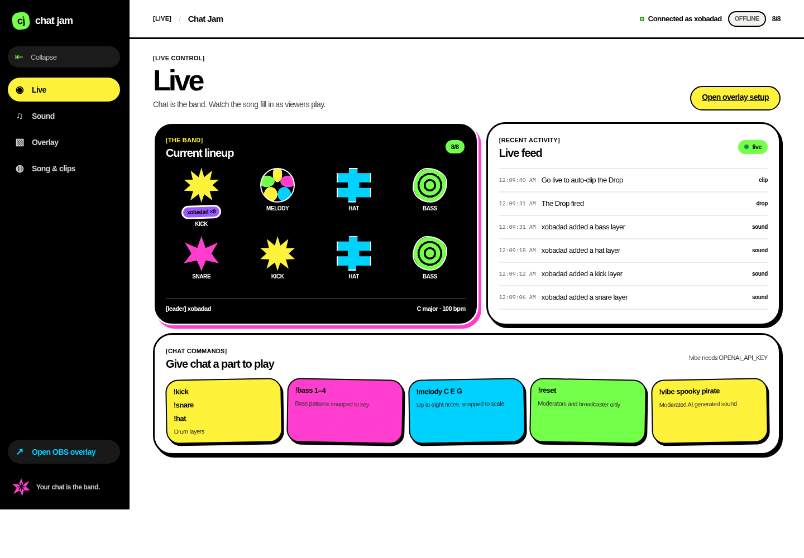
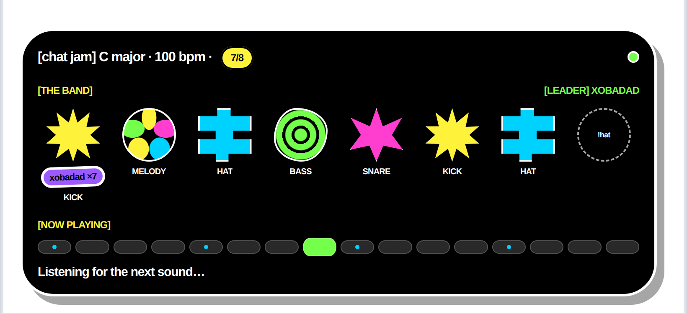
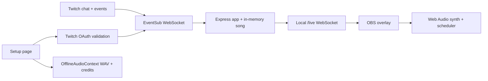

# Chat Jam

Chat Jam turns a Twitch chat into a live band. Viewers add synthesized layers; filling all eight slots starts The Drop and requests a Twitch clip. The OBS overlay shows the band and song grid, and the setup page can export four loops, the Drop, and contributor credits as a WAV and text file.

## Run it

1. Clone the repo and run `npm install` with Node.js 22 or newer.
2. The public Twitch Client ID is already set in `src/config.ts`. To use your own Twitch app instead, replace `TWITCH_CLIENT_ID` there (or set the `TWITCH_CLIENT_ID` environment variable) and set that app's redirect URL to `http://localhost:3000/callback`.
3. Run `npm start`, open `http://localhost:3000`, choose **Connect with Twitch**, and approve access.
4. In OBS, add a **Browser** source at `http://localhost:3000/overlay`, set it to 1920×1080, tick **Control audio via OBS**, and set the level in the Audio Mixer.
5. To enable early Drops, open Twitch Creator Dashboard → Viewer Rewards → Channel Points → Manage Rewards, add a reward, and name it **Drop the beat**.

Twitch access tokens are validated and kept in memory; Chat Jam has no database and never posts chat replies.

## Commands

| Chat command              | Effect                                                   |
| ------------------------- | -------------------------------------------------------- |
| `!kick`, `!snare`, `!hat` | Add a drum layer                                         |
| `!bass 1`–`!bass 4`       | Add a bass pattern snapped to the selected key and scale |
| `!melody C E G`           | Add up to eight snapped notes                            |
| `!vibe spooky pirate`     | Ask OpenAI for a moderated, structured music layer       |
| `!reset`                  | Clear the song (moderators and broadcaster only)         |

Each viewer can add a layer every five seconds and use `!vibe` every thirty seconds. Set `OPENAI_API_KEY` before starting (for example, `OPENAI_API_KEY=your-key npm start`) to enable `!vibe`; without it, the setup page and overlay display that the command is off.

## How it works

The server code is split across `src/twitch/` for OAuth, EventSub, and Helix; `src/song.ts` owns layer and Drop state; `src/vibe.ts` handles optional AI. The browser overlay has separate synth, scheduler, view, Drop, and socket modules. The WAV export uses the same synthesized voices as the live overlay.

## Development

- `npm run format` formats the repo with Prettier.
- `npm run lint` runs ESLint with the flat TypeScript config.
- `npm test` runs Vitest.
- `npm run typecheck` checks TypeScript.
